# 🧩 How the detector works

One pass through the network turns an image into a fixed list of boxes. This page follows that pass in five stages and says which source file owns each one. The numbers on the [NMS comparison page](nms-vs-nms-free.md) and in the [reproduction report](../REPRODUCTION_REPORT.md) come from exactly this path.

*Each stage lights up in turn; with reduced motion enabled the sketch stays fully lit. It shows the data path, not measured output.*

## 🔎 The five stages

1. **Image.** A letterboxed square, 640 px for detection, segmentation and keypoints, 1024 px for oriented detection tiles.
2. **Backbone and neck.** One trunk, shared by all four tasks, turns the image into feature grids at strides 8, 16 and 32. A stride-8 cell sees a small patch and decides about small objects; a stride-32 cell sees a large patch and decides about large ones.
3. **Two heads on the same grids.** Every grid cell is an *anchor point*. Each head predicts, for each anchor, class scores and four distances (left, top, right, bottom) from the anchor to the box edges. There are no distribution bins to decode: the distances are the box (`models/heads/detect.py`).
4. **Top-k.** The deployed head's class scores are ranked and the best 300 are kept (`decode/topk_e2e.py`). Rows past the real detections carry score 0, so the output shape is always `(batch, 300, 6)`: `[x1, y1, x2, y2, score, class]`.
5. **Boxes.** That tensor is the answer. Nothing after it merges or filters boxes.

## 🪞 Why two heads

The two heads read the same features and differ in what they are taught during training.

|  | one-to-many head | one-to-one head |
| -- | -- | -- |
| Training target | several anchors per object count as positives | exactly one anchor per object counts as positive |
| Effect | dense, strong gradient signal for the shared trunk | learns to fire once per object |
| At inference | optional: feeds the NMS path | deployed: feeds top-k |

Training blends the two losses and shifts weight from the dense head to the sparse one as the run progresses (Progressive Loss, `losses/progressive.py`: `alpha` ramps from 0.8 to 0.1 over the epoch budget). The dense head is why the trunk learns quickly; the sparse head is why inference needs no cleanup.

## 🧭 Where to look in the code

| Stage | Source |
| -- | -- |
| heads, ltrb boxes | `models/heads/detect.py` |
| assignment (which anchors are positive) | `assign/tal.py`, `assign/stal.py` |
| NMS-free decode | `decode/topk_e2e.py` |
| classic decode, for comparison | `decode/nms_path.py` |

Every mechanism above is traced to a numbered section of the source paper in the [reproduction report's *What was reproduced*](../REPRODUCTION_REPORT.md) table. What the project had to assume where the paper is silent is in the [assumption register](../ASSUMPTIONS.md).

Next: [what removing NMS costs](nms-vs-nms-free.md).
