# ⚖️ NMS versus NMS-free

Non-maximum suppression (NMS) is the cleanup step most detectors run after the network: a dense head proposes many overlapping boxes per object, and NMS keeps the best one. This version of the detector can run that path, and also a path with no cleanup at all. Both decode the same weights, so the difference is measured, not argued.

*Illustrative sketch with made-up scores. The measured gap is in the table below.*

## 🧱 What each path does

|  | With NMS | NMS-free |
| -- | -- | -- |
| Reads | the one-to-many (dense) head | the one-to-one head |
| Steps | confidence threshold, class-wise NMS, keep at most 300 | rank by score, keep 300 |
| Settings | confidence threshold (0.001), IoU threshold (0.7) | none beyond k |
| Overlap test | yes, pairwise IoU | none |
| Output | `(batch, 300, 6)` | `(batch, 300, 6)` |
| Source | `decode/nms_path.py` | `decode/topk_e2e.py` |

The NMS-free path has no suppression operator in its source at all, and a meta-test pins that by reading the file. Two heavily overlapping high-score boxes would both survive it. That is safe only because the one-to-one head was trained so that it does not produce them.

## 📏 What it costs in accuracy

Same weights, both paths, `n` scale, roughly 50 epochs, seed 0. Both tables below are included from the reproduction report, not copied, so they always show what the report says.

The cost of dropping NMS, per tier, from the [consolidated note](../report/consolidated-note.md):

--8<-- "report/consolidated-note.md:nms-cost"

The keypoint tier scored both paths too, on COCO val2017 ([keypoints section](../report/keypoints.md)). Here the box branch loses a little without NMS while the point branch does not:

--8<-- "report/keypoints.md:eval"

The source paper reports a gap of 0.6 to 0.8 AP. This reproduction measures a wider one on a short schedule. The report records that as its own claim and does not explain it away; whether it closes with longer training is an open question.

## ❔ What this project has not measured

- **Speed.** Nothing in this repository times the two decode paths against each other, so no latency or throughput claim is made here.
- **Oriented detection.** The oriented tier reports per-tile scores and has never run the NMS comparison. It also has an open policy question on the NMS-free side: two overlapping tiles that detect the same object have nothing to suppress the duplicate, so merging them is a decision still to be made.
- **Longer schedules.** Every figure above is from a smoke-tier run at the smallest scale.

## 🧠 Why bother removing it

The honest answer from the evidence here is narrower than the usual pitch. What the code shows: the NMS-free output has a fixed shape with no data-dependent step, no IoU threshold to tune, and one fewer operator to trace and export. What the measurements show: that simplicity costs about one to one and a half AP in this reproduction. Whether the trade pays off for a given deployment depends on latency numbers this project has not collected.
