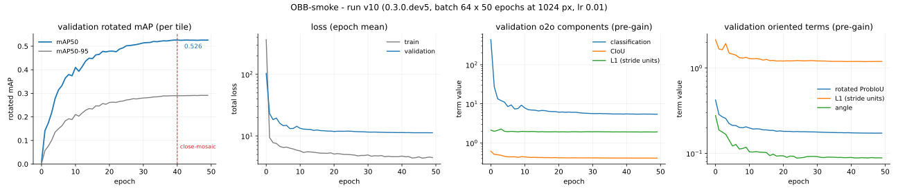

# 🔄 0.3.0 — Oriented detection

The OBB-smoke tier has run and was **accepted 2026-08-14** at roadmap 064's `[PRINCIPAL]` gate. This section records what the run measured, what it can and cannot be compared against, and where the criterion `obb_smoke.yaml` stated no longer fits the instruments — the acceptance was given on the first two, and explicitly not on the third.

## What was reproduced

Oriented detection as [R1] describes it: the same DFL-free dual head and NMS-free one-to-one deploy path, with per-branch angle stems, the axis-aligned box terms replaced by rotated ones, and R1 Eq. 15's angle term added.

| mechanism | reference | implementation |
| -- | -- | -- |
| oriented head | [R1] sec. 3.4.3, A44, A45 | `models/heads/obb.py` — `decode_rboxes` composes the ltrb rectangle with the predicted heading; `o2o_rotated_topk` ranks boxes and gathers each angle by the anchor its own box was ranked by |
| rotated IoU loss | R17, A49 | `losses/probiou.py` — the bounded Hellinger form, restructured so it needs no float64 (MPS has none) |
| retargeted L1 | A50 | the L1 slot moved onto the rotated box's own `(cx, cy, w, h)`; the axis-aligned envelope target fights the rotated term at every non-zero `theta` |
| angle term | [R1] Eq. 15, A22 | `losses/oriented_loss.py` at gain 0.25, lowered from 1.0 by [WP-093](../work_packages/wp-093.md) |
| rotated assignment | A25 | one assignment shared by every term, with rotated **candidacy** only: `gt_rboxes` reaches the assigners and nothing else |
| rotated mAP | A24 | `eval/dota_eval.py` — exact polygon-intersection IoU by Sutherland-Hodgman clipping, ten thresholds, 101-point interpolated recall, 300 detections per tile, R18's difficult rule (A48) |
| 1024 px tiling | R18 sec. 4, A21, A52 | `data/tiling.py` + `lucid-data build-tiles` — overlapping crops, parts below 70% of original area flagged difficult |

Parameter and FLOP fidelity is gated against **this project's own frozen goldens**, not against the paper: [R1] publishes no oriented parameter table (n: 2.56M/14.68G at 1024 px, `goldens/params_flops_obb.json`). Those numbers catch drift; they corroborate nothing.

The fast wiring gate runs before any DOTA launch: `scripts/overfit_micro.py --task obb` reaches train rotated mAP50 **0.9390** over 592 instances against a 0.9 floor, decoded through the deployed one-to-one path (`goldens/gpu/overfit_micro_obb.json`).

## The OBB-smoke run

**Run v10** — `0.3.0.dev5`, DOTA-v1.0 train tiled at 1024 px with 512 px overlap, `task: obb`, n scale, batch 64, lr 0.01, MuSGD, warmup 3 epochs then linear decay to `lr0 * 0.01`, close-mosaic for the final 10, EMA (decay 0.9999, tau 2000), gradient clip 10.0, bf16-mixed, seed 0, `deterministic: true`, 50 epochs = 23,050 steps on one RTX PRO 6000 (operator-reported; the run artifacts record no device), 7h29m wall clock — about 9 minutes an epoch, derived from the artifact timestamps rather than logged, since no per-epoch timing was recorded here either. Gains: ProbIoU 7.5 (A49, Hellinger), rotated L1 6.0 (A50), angle 0.25 (A22), classification 0.5 unchanged.

The tiling overlap is **512 px, R18's own protocol figure, not A21's 200 px default** — a choice the tier made and the register did not, which is recorded here because the two differ by a factor of 2.6 in tiles per image and therefore in everything downstream of tile count.

Evaluated by `lucid-eval` on the DOTA-v1.0 val split, tiled identically: 10,132 tiles, 101,209 instances, 16,528 of them difficult.

<!-- --8<-- [start:eval] -->

| weights | rotated mAP50-95 | rotated mAP50 | rotated mAP75 | rotated mAR_300 |
| -- | -- | -- | -- | -- |
| EMA | **0.2914** | 0.5242 | 0.2770 | 0.5075 |
| raw | 0.2867 | 0.5140 | 0.2734 | 0.5013 |

<!-- --8<-- [end:eval] -->

EMA is worth `+0.0047` mAP50-95 — small, positive, and the opposite sign to Det-smoke, where raw scored marginally higher.

**Every figure above is per tile.** Detections from overlapping tiles are not merged back onto whole images here: on an NMS-free path two tiles detecting one object have nothing to suppress the duplicate, so the merge is a policy that must be decided rather than inherited. [WP-107](../work_packages/wp-107.md) built that policy and roadmap 111 runs it against this checkpoint, below. A per-tile score never pays the duplicate cost whole-image evaluation charges, so **these numbers are not comparable to published DOTA results**. That is a property of the measurement, not a hedge about its precision.

**Two independent measurements agree to four decimals.** The same checkpoint scores 0.2914 / 0.5242 on Apple MPS here and 0.2914 / 0.5243 on CUDA in the operator's own run — two accelerators, two tile builds from the same source archive, two machines. That is evidence about the evaluator and the tiler, not about the model, and it is the strongest cross-platform agreement this project has recorded; A26 still declines to claim bitwise reproduction.

## The whole-image figure (roadmap 111)

The same checkpoint, re-scored through `merge_whole_images` ([WP-107](../work_packages/wp-107.md)) on the same DOTA-v1.0 val split, CUDA, 458 source images:

| weights | scope | rotated mAP50-95 | rotated mAP50 | rotated mAP75 | rotated mAR_300 |
| -- | -- | -- | -- | -- | -- |
| EMA | per tile | 0.2914 | 0.5242 | 0.2770 | 0.5075 |
| EMA | whole image | **0.3146** | 0.5484 | 0.3111 | 0.5193 |

Every figure rises, not falls. [WP-107](../work_packages/wp-107.md)'s own log entry states the merge in isolation "can only *lower*" a per-tile number, and that remains true of core ownership alone — the reason this run runs the other way is A60, exercised here for the first time against real data: whole-image scoring drops the per-tile 300-detection cap (`o2o_rotated_topk`'s own emission limit, A47), because a source image assembled from roughly 22 tiles is not one forward pass and re-imposing 300 on it would measure a truncation rather than the model. That cap-lifting and the core-ownership merge run together in this measurement rather than separately, so the split between them is not isolated here — see [research log](../work_packages/wp-111.md#wp-111).

This is, for the first time, a figure of the same *statistic* [R1 Tables 10-11] report — whole-image rotated mAP. It is still not compared against those tables in this section: the deviations below (epoch budget, no pretraining, batch/resolution choices) stand regardless of which statistic is quoted, and the design's own target is the paper's relative claims, not its absolute ones (design doc §5.11, §7).

## Acceptance, and a criterion that no longer fits

`obb_smoke.yaml` asks for "stable training and a rotated mAP50 that tracks the box mAP". The second half **cannot be evaluated on this run, by construction**: [WP-102](../work_packages/wp-102.md) stopped logging `val/mAP` for oriented runs, because that figure reads the A44 composition's pre-rotation rectangle and therefore scores a run with correct orientations and one with random orientations identically. A criterion asking a rotated metric to track a number that was removed for being uninformative is a criterion that outlived its instrument.

What the acceptance was given on:

| criterion | required | observed |  |
| -- | -- | -- | -- |
| wiring gate | train rotated mAP50 ≥ 0.9 | **0.9390** | ✓ |
| training completed | 50/50 epochs, all logged | 50 validation rows, no gaps | ✓ |
| no divergence | — | `val/loss` 103.79 → 11.2470, minimum 11.2447 at epoch 48; 15 of 49 steps rise, the largest 8.4% at epoch 9, every rise after epoch 32 at most 0.15% | ✓ |
| rotated mAP50 | *criterion unfit — see above*; recorded, not cleared | **0.5242** EMA, per tile | — |
| Phase ≤8 gates | green | 1,555 tests, 20/20 goldens — the seven live sets, `frozen/0.2` and the `frozen/0.3` snapshot this release cut | ✓ |

The stability row is stated precisely because Det-smoke and Seg-smoke both recorded strictly monotone validation descent and this run did not. Fifteen of forty-nine epoch-to-epoch steps rise, and the shape of that set is what makes it noise rather than divergence: the only two rises worth a number are 5.7% at epoch 3 and 8.4% at epoch 9, inside the warmup and just after it, while every rise from epoch 32 onward is at most 0.15% — six of them, on a curve that is by then flat to three decimals. The minimum is at epoch 48 rather than 49, by 0.0023. This is a different observation from the earlier two tiers, so it is written as one rather than folded into the same "monotonic" phrase.

**What a fit criterion would need.** Roadmap 111, below, delivers the whole-image number this project could compare against anything published — but no such comparison is drawn in this section, deliberately (design doc §5.11, §7): the smoke tier's epoch budget, missing pretraining and resolution choices stand whichever statistic is quoted. The honest statement remains the one this section makes: a per-tile rotated mAP50 of 0.52 from a 50-epoch n-scale run, on a task whose wiring gate passes at 0.94, with no external reference point.

## Reading the training curves



*Run v10, four panels. The per-tile rotated mAP (both mAP50 and mAP50-95) logged at each epoch end; epoch-mean totals; the one-to-one branch's pre-gain components; and the oriented terms that replace two of them.*

Three things a reader should not misread.

**Panels 3 and 4 overlap, and panel 3's box curves are inert.** `val/o2o_box` and `val/o2o_l1` are computed and logged as diagnostics, but the dual loss is constructed with `box_gain = 0` and `l1_gain = 0` under this task, so no gradient ever followed them; the live terms are `rbox` and `rl1` in panel 4. `val/o2o_box` drifting 0.61 → 0.41 is the axis-aligned envelope of boxes that improved for other reasons. The zeroing is done inside the dual loss rather than by subtracting afterwards, because `(c + b) - b` is not `c` in floating point.

**The opening loss is the classification term, not a defect.** `train/loss` starts at 365 and `val/loss` at 104, against Det-smoke's tens. Nearly all of it is classification at initialization — `train/o2o_cls` starts at 2085 and ends at 1.94, `val/o2o_cls` at 436 and ends at 5.44 — which is what a 15-class objective over the anchor count of a 1024 px input looks like before the prior bias is learned. The rotated terms never show that scale: `rbox` starts at 0.51, `rl1` at 1.91, `angle` at 0.40.

**The metric is flat for the last ten epochs, and that is a finding.** `val/rotated_mAP50` peaks at 0.5262 at epoch 40 — the epoch close-mosaic fires — and ends at 0.5257, a change of `-0.0001` across the whole close-mosaic window. The curve had converged before mosaic was disabled, so this run shows **none** of the late-epoch lift close-mosaic exists to produce. On Det-smoke that window was worth real accuracy. Two readings are available and this run cannot separate them: either 50 epochs is past the point where this n-scale model has anything left to gain on this data, or the oriented objective's ceiling is set by something the schedule does not touch — A44 being the candidate. Whichever it is, more epochs is not the obvious next experiment.

## Assumption outcomes

Assumptions the oriented tier exercised. Full register in `ASSUMPTIONS.md`.

| id | subject | outcome |
| -- | -- | -- |
| A21 | DOTA crop overlap | **not exercised at its recorded value** — the tier ran at R18's 512 px, not the register's 200 px default. The parameter carried the change without incident; the assumption's own value remains unmeasured |
| A22 | angle-term weight, 0.25 | **held** — the term falls 0.40 → 0.049 (train) and 0.28 → 0.088 (val) without displacing the box terms; [WP-093](../work_packages/wp-093.md)'s reduction from 1.0 is what this run trained under |
| A24 | rotated-IoU metric and its protocol | **held** — produces the figures above, and agrees to four decimals across MPS and CUDA |
| A25 | rotated candidacy in TAL/STAL | **held** — one assignment, rotated containment only; the wiring gate at 0.94 is the evidence that positives reach the right anchors |
| A44 | how the angle composes with ltrb | **carries the run, and bounds it** — every number here is produced by this composition. It is the first thing to ablate, and its cost cannot be read off any metric this run logs, since the axis-aligned view of it is exactly the view [WP-102](../work_packages/wp-102.md) removed |
| A45 | oriented output tuple, width 7 | **held** — the deployed decode and the metric adapter share it |
| A48 | difficult-instance matching | **exercised at scale** — 16,528 of 101,209 val instances are difficult, so 16% of the ground truth is governed by this rule; a wrong reading of it would move the reported number materially |
| A49 | Hellinger ProbIoU at gain 7.5 | **held** — `rbox` falls 0.51 → 0.14 (train), 0.42 → 0.17 (val), stably, at the gain A13 set for the axis-aligned term |
| A50 | retargeted L1 at gain 6.0 | **held** — `rl1` falls 1.91 → 0.40 (train), 2.15 → 1.20 (val); the retargeting is what makes those two terms agree rather than fight |
| A52 | object-free crops kept | **exercised** — 3,956 of 10,132 val tiles carry no annotation. Nearly 40% of the split is background-only, which is a large share of what both training and evaluation saw |

## Deviations from the paper, and from the earlier tiers

1. **Epoch budget.** 50 epochs at n scale, against the paper's from-scratch schedules. A smoke tier by design.
2. **No Objects365 pretraining, no evolutionary hyperparameter search** (D2).
3. **No comparison to the paper's oriented numbers.** [R1 Tables 10-11] report whole-image rotated mAP50-95 on DOTA-v1.0 val; this section now reports that statistic too (roadmap 111), but deliberately does not set it beside R1's figures — the epoch budget, missing pretraining and other deviations in this list apply regardless of which statistic is quoted, and the design's own target is the paper's relative claims (design doc §5.11, §7).
4. **Batch 64 at 1024 px**, against 128 at 640 for the COCO tiers — 2.56× the pixels per image, so a third more pixels per step than Det-smoke's budget rather than a match for it. `lr` stayed at the config's 0.01 rather than being scaled.
5. **512 px tiling overlap**, R18's figure rather than A21's default; see above.
6. **The angle gain is this project's, not the paper's.** [R1] states Eq. 15 and its internal lambda and never its weight against the other terms; 0.25 is A22's reasoning, revised once already.
7. **The parameter gate has no published reference** for this task family, unlike detection ([R1 Table 7]) and segmentation ([R1 Table S9]).

## Reproducing this result

```bash
lucid-data check       --data_root <dota> --dataset dota --expected_images 1869 --expected_instances 127843
lucid-data build-tiles --root <dota> --out <tiles> --splits train,val --patch 1024 --overlap 512 --workers 8
lucid-yolo fit --config obb_smoke.yaml \
  --data.data_root <tiles> --data.batch_size 64 --data.num_workers 32 \
  --data.prefetch_factor 4 --data.persistent_workers true --model.lr 0.01 \
  --trainer.max_epochs 50 --trainer.precision bf16-mixed
lucid-eval --checkpoint <checkpoint> --data_root <tiles> --split val --output obb_report.json
```

DOTA is provisioned by hand — see `DATASETS.md`; it is neither downloaded by this project nor redistributable through it, and its terms are academic use only.

Seed 0 throughout. Cross-platform bitwise reproduction is not claimed (A26), though this tier's two independent evaluations agree to four decimals. The metric reports are archived under `.experiments/obb_smoke/`, and the run config, hyperparameters and epoch metrics under `lightning_logs/version_10/`.
