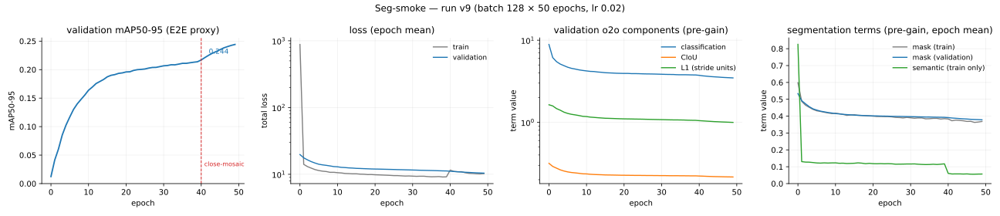

# 🖌️ 0.2.0 — Instance segmentation

The Seg-smoke tier has run and was **accepted 2026-08-10** at roadmap 054's `[PRINCIPAL]` gate, together with the numeric criterion below, which `seg_smoke.yaml` had stated only qualitatively. This section records what the run measured and what it was measured against.

## What was reproduced

Instance segmentation as [R1] describes it: prototype masks assembled by per-instance coefficients, read out of the same one-to-one branch the NMS-free detector deploys, with a training-only auxiliary semantic branch shaping the shared features.

| mechanism | reference | implementation |
| -- | -- | -- |
| prototype–coefficient masks | [R1 Eq. 7], R16 | `models/heads/proto.py` — `ProtoFusion` builds the shared feature, `ProtoNet` emits K=32 prototypes at 160×160 (A15), `assemble_masks` is the einsum of Eq. 7 |
| coefficient stems on the dual head | A14, A34 | `models/build.py` — `num_coeffs` enables a coefficient stem on each branch; tanh activation per A16 |
| instance mask loss | A16 | `losses/mask_loss.py` — per-pixel BCE cropped to the GT box, normalized by box area, sharing the A11 half-open pixel-centre rule |
| auxiliary semantic branch | [R1 sec. 3.4.1], A17 | `models/heads/semantic.py` — one 1×1 convolution, A30 prior bias, `forward` returning `None` in eval mode; `losses/semantic_loss.py` supervises it with BCE + soft Dice |
| mask decode | A37 | `eval/segment_decode.py` — assemble, sigmoid, bilinear upsample, box crop, threshold 0.5, nearest-neighbour inverse letterbox |

Parameter and FLOP fidelity is gated, not asserted: `test_param_flops.py` holds all five segmentation scales within ±3% params and ±5% FLOPs of [R1 Table S9] (n: 2.72M/9.00G). The parameter tolerance is wider than detection's ±2% because the head's sizing rests on five assumptions (A14, A15, A18, A34, A35) rather than on published structure.

The fast wiring gate runs before any COCO launch: `scripts/overfit_micro.py --task segment` reaches train mask IoU **0.8146** over 592 instances against a 0.7 floor, decoded through the deployed one-to-one path (`goldens/gpu/overfit_micro_seg.json`).

## The Seg-smoke run

**Run v9** — COCO 2017 train, `task: segment`, n scale, batch 128, lr 0.02, MuSGD, warmup 3 epochs then linear decay to `lr0 * 0.01`, close-mosaic for the final 10, EMA (decay 0.9999, tau 2000), gradient clip 10.0, bf16-mixed, seed 0, `deterministic: true`, 50 epochs = 46,250 steps on an unrecorded Colab GPU. `mask_gain 2.5`, `semantic_gain 0.5` (A38).

Evaluated on the full COCO val2017 (5000 images) at 640 px with `scripts/eval_det.py`, one forward per batch decoding both paths, boxes and masks scored by separate `torchmetrics` `MeanAveragePrecision` instances on the `faster_coco_eval` backend — masks at original image resolution against ground truth decoded from the COCO polygons (R12). EMA weights; raw weights were not evaluated for this run.

<!-- --8<-- [start:eval] -->

| path | box mAP50-95 | box mAP50 | box mAP75 | segm mAP50-95 | segm mAP50 | segm mAP75 | segm mAR_100 |
| -- | -- | -- | -- | -- | -- | -- | -- |
| NMS | **26.12** | 39.12 | 27.93 | **19.01** | 34.40 | 18.63 | 32.75 |
| E2E | 24.85 | 37.25 | 26.59 | 18.20 | 32.72 | 18.03 | 32.50 |

<!-- --8<-- [end:eval] -->

By size bucket, segm against box on the NMS path: **3.74 / 20.06 / 31.79** segm against 12.33 / 28.54 / 34.86 box for small / medium / large.

The NMS-free path costs 1.27 box AP and 0.81 segm AP.

## Seg-smoke acceptance

`seg_smoke.yaml` asks for "stable training and a segm mAP that tracks the box mAP". That is a ratio statement, and a ratio is the right shape: it survives a change of scale or schedule where an absolute floor would have to be re-derived for every tier. What it lacked is a number.

**Accepted 2026-08-10** at roadmap 054, the criterion below with it: it is the standing Seg-tier criterion from here, not a reading of this run alone.

| criterion | required | observed |  |
| -- | -- | -- | -- |
| stable training | no divergence | `val/loss` strictly decreasing across all 49 logged epochs, 19.739 → 10.403 | ✓ |
| wiring gate | train mask IoU ≥ 0.7 | **0.8146** | ✓ |
| box mAP50-95 | > 25, the Det-smoke floor unchanged | **26.12** EMA-NMS | ✓ |
| mask-to-box ratio | segm mAP50-95 ≥ **0.65 ×** box mAP50-95, same weights, same path | **0.728** NMS, **0.732** E2E | ✓ |
| Phase ≤6 gates | green | 867 tests, 12/12 goldens — the six live sets and the `frozen/0.2` snapshot this release cut from them | ✓ |

The box floor is carried over from Det-smoke rather than dropped, because a ratio alone cannot fail a run that collapsed: halve both numbers and the ratio is unchanged. The two criteria answer different questions — the floor asks whether the detector still works, the ratio asks whether the masks followed it — and a tier that supervises masks *on top of* the detection objective needs both, or a regression in the shared trunk passes as a segmentation success.

The ratio is bounded above by construction: every mask starts from a detection this same model produced and is cropped to it, so segm mAP could equal box mAP only if every mask were exact inside its own box. The question is only how far below, and the run answers it in a way that says where the loss comes from. The mask-to-box ratio is **0.879** at IoU 0.50 — identical to three decimals on both decode paths — and falls to 0.667 (NMS) / 0.678 (E2E) at IoU 0.75. Across sizes it is 0.30 small, 0.70 medium, 0.91 large. The model finds and labels instances about as well as its boxes do; it pays at the boundary, and it pays most where the prototype grid is coarsest relative to the object. At 160×160 for a 640-pixel input (A15), one prototype cell is 4 input pixels: a 32-pixel object spans 8 cells, and below that quantization dominates whatever the coefficients predict.

A floor at 0.65 leaves about 11% relative headroom under the observed 0.728. That band is wide enough to absorb what legitimately moves the aggregate ratio — a different small/medium/large mix, since the buckets themselves span 0.30 to 0.91, plus seed and precision noise — and it is far above where the failures this gate exists to catch would land. Coefficients gathered against the wrong anchors, thresholding before upsampling (A37 ii), a crop in the wrong frame, or an unsupervised one-to-one coefficient stem (A38 ii) do not shave a tenth off the ratio; they collapse it, because the mask either degenerates or lands on the wrong object. A criterion has to separate the failure it names from the noise it should tolerate, and 0.65 does.

**An observation, offered as one.** The segmentation run's box accuracy is above Det-smoke's: 26.12 against 25.30 on EMA-NMS, 24.85 against 23.84 on EMA-E2E. So mask supervision did not cost box accuracy here. It is not a measurement of what mask supervision costs, because the two runs differ in more than the task — bf16-mixed against 16-mixed, different hardware, and the data-pipeline work that landed in between — and each is a single seed. It belongs in the record, not in the criterion table.

## Reading the training curves



*Run v9, four panels. The epoch-end E2E mAP proxy logged during training (letterbox coordinates — the figures above come from the standalone evaluator); epoch-mean totals; the one-to-one branch's pre-gain components, the L1 term in stride units; and the pre-gain segmentation terms, epoch-mean. The last panel plots the mask term for both splits and the semantic term for training only — the eval-mode branch produces nothing to plot.*

Three things a reader should not misread.

**`val/semantic` is 0.0 at every logged epoch, and that is correct.** The auxiliary semantic branch is training-only by design: `forward` returns `None` whenever the module is not in training mode, keyed on module mode and never on grad mode (A17), so at validation there is no logit to score and the term contributes nothing. A flat zero is the branch being provably absent, not a branch that failed to learn. The branch that *is* learning shows up in `train/semantic`, which falls from 0.826 at epoch 0 to 0.057 at epoch 49. The same design is what lets the fused-parameter gate account for exactly one convolution disappearing at deploy.

**`val/mAP` is a letterbox-frame proxy, not the acceptance figure.** It scores the E2E path in letterbox coordinates during validation; IoU is invariant to each image's uniform letterbox scaling, so it tracks the original-coordinate protocol closely — 0.2442 at epoch 49 against the standalone evaluator's 0.2485 E2E — but the authoritative number is `scripts/eval_det.py` at original resolution, as it is for Det-smoke. `val/mask` (0.5338 → 0.3783) is the mask loss term, not a mask metric.

**One validation row is missing from the log, not from the run.** The CSV carries 49 validation rows for 50 epochs: epoch 29's is absent. The training rows run continuously across that boundary (step 27,699 to 27,799) and `val/mAP` resumes its ascent at epoch 30, so this is a logging gap.

A `val/segm_mAP` metric now exists, decoding the kept detections' masks through the deployed A37 path and scoring them at the prototype grid — a proxy in exactly the sense `val/mAP` already is. It landed after this run, so **no epoch of run v9 carries it**; it is available to future segmentation runs, where it removes the situation this one was in, of a segmentation run whose only epoch metric was about its boxes.

## Assumption outcomes

Assumptions the segmentation tier exercised. Full register in `ASSUMPTIONS.md`.

| id | subject | outcome |
| -- | -- | -- |
| A15 | prototype resolution, 160×160 at 640 input | **held** — carries the run; the size-bucket split (0.30 small against 0.91 large mask-to-box) is where its cost is visible, and it is the first thing to ablate if masks are the target |
| A16 | tanh coefficients, box-cropped area-normalized BCE | **validated at the wiring scale** — train mask IoU 0.8146 against a 0.7 floor; COCO-scale masks train stably under it |
| A17 | training-only auxiliary semantic branch | **validated** — `val/semantic` 0.0 at every logged epoch is the branch's eval-mode absence, and `train/semantic` falls 0.826 → 0.057, so the branch trains and disappears exactly as specified |
| A37 | mask-decode numerics the papers leave open | **held** — the full-val2017 segm figures are produced by this decode; a wrong threshold order or crop frame would show as a collapsed ratio, and the ratio is 0.73 |
| A38 | mask/semantic gains and which branch is supervised | **held** — 2.5 / 0.5 keep both terms live without displacing the detection objective; box accuracy did not regress against Det-smoke |
| A11 | anchor centre placement | unchanged from detection; the mask crop reuses its `+0.5` half-open rule rather than defining a second one |

## Deviations from the paper, and from Det-smoke

1. **Epoch budget.** 50 epochs at n scale, against the paper's from-scratch 500/600-epoch schedules. Seg-smoke is a smoke tier by design.
2. **No Objects365 pretraining, no evolutionary hyperparameter search** (D2).
3. **bf16-mixed, where Det-smoke ran 16-mixed.** A hardware-driven choice, not a measured one; the two precisions have not been compared on this codebase.
4. **lr 0.02, overriding `seg_smoke.yaml`'s 0.01.** The file carries the batch-64 recipe value; the run used the batch-128 linear scaling that Det-smoke settled on. As there, the unscaled value has no clean measurement of its own.
5. **The mask gains are this project's, not the paper's.** [R1] gives no gain for either segmentation term; 2.5 and 0.5 are A38's reasoning, argued from where the terms sit in the converged regime rather than from a published number.
6. **Raw weights unevaluated**, so the EMA contribution is unmeasured for this run — Det-smoke reports both.

## Reproducing this result

```bash
lucid-download --data-root <root> --splits train val --verify
lucid-yolo fit --config seg_smoke.yaml \
  --data.data_root <root> --data.batch_size 128 --data.num_workers 32 \
  --data.prefetch_factor 2 --model.lr 0.02 --trainer.max_epochs 50 \
  --trainer.precision bf16-mixed
python scripts/eval_det.py <checkpoint> --data-root <root>
```

As above, these are the commands as run and are left unedited; the 0.3.0 spellings are `lucid-data download` and `lucid-eval` ([WP-096](../work_packages/wp-096.md)). The config was renamed after this run too: `seg_smoke.yaml` is today `seg_nano_smoke.yaml` (`variant: n`, [WP-136](../work_packages/wp-136.md)), and the `--config seg_smoke.yaml` line above resolves only under the new name.

Seed 0 throughout. The package version installed for run v9 is not recorded in any of its artifacts. Cross-platform bitwise reproduction is not claimed (A26); the metric report is archived under `.experiments/seg_smoke/`, and the run config, hyperparameters and epoch metrics under `lightning_logs/version_9/`.
